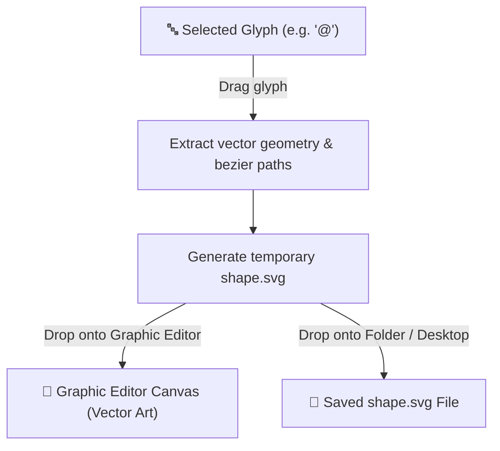

# VectorCharMap

<p align="center">
  
</p>

<p align="center">
  <strong>A modern Windows character map application that turns font glyphs into clean, scalable vector graphics (SVG).</strong>
</p>

<p align="center">
  
  
  
  
</p>

---

## 📖 Overview

**VectorCharMap** is a desktop character map designed specifically for designers, typographers, and vector artists. 

Instead of copying raster text or static bitmaps, **VectorCharMap** extracts the exact vector path geometry of any glyph from any installed system font. You can drag and drop characters directly into your favorite vector design suite as editable bezier paths, drop them onto your desktop or any folder to create instant `.svg` files, or batch export entire font families.

---

## ✨ Features

- 🎯 **Direct Drag-and-Drop into Vector & Raster Editors**  
  Drag any character straight from the grid into vector editors like **Adobe Illustrator**, **Inkscape**, **Figma**, **Affinity Designer**, **CorelDRAW**, or **Blender** as pure vector artwork.
  - You can also drop vector glyphs directly into raster/hybrid image editors that support vector layers or Smart Objects (such as **Adobe Photoshop**, **Affinity Photo**, **GIMP**, **Krita**, or **Pixlr**).

- 📁 **Instant SVG File Creation**  
  Drag a glyph directly into Windows Explorer, a desktop folder, or any file container to instantly create a ready-to-use `shape.svg` file.

- ⚡ **Batch Export ("Export All")**  
  Export every character available in a chosen font and style combination to a selected folder with a single click.

- 📐 **Full Typography Control (OpenType Support)**  
  Fine-tune font parameters in real time before exporting:
  - **Weight:** Full OpenType range from `100 (Thin)` to `950 (Extra Black)`
  - **Style:** `Normal`, `Italic`, `Oblique`
  - **Stretch:** From `UltraCondensed` to `UltraExpanded`
  - **Output Size:** Configurable em-size for precision scaling

- 🖋️ **Outlined Vector Mode**  
  Toggle the **Outlined** checkbox to generate widened outline strokes rather than filled shapes.

- 📚 **Unicode Character Database (UCD) Integration**  
  Integrated Unicode lookup displays character names, categories, and Unicode code points for every glyph in the font.

- 🌓 **Dark & Light Themes**  
  Dark and light UI theme.

- 🌐 **Multilingual Interface**  
  Built-in support for **English** and **Bulgarian**.

---

## 🚀 Getting Started

### Prerequisites

- **Windows 10 / 11**
- **[.NET Core 3.1 SDK](https://dotnet.microsoft.com/download/dotnet/3.1)** (or higher)

### Building from Source

1. **Clone the repository:**
   ```bash
   git clone https://github.com/MitkoNed21/VectorCharMap.git
   cd VectorCharMap
   ```

2. **Restore dependencies & build:**
   ```bash
   dotnet build VectorCharMap.sln -c Release
   ```

3. **Run the application:**
   ```bash
   dotnet run --project VectorCharMap.csproj
   ```

---

## 🕹️ How to Use

1. **Select a Font:** Choose any font installed on your system from the dropdown.
2. **Configure Typography:** Adjust **Weight**, **Style**, **Stretch**, and set your desired **Output Size**.
3. **Choose Mode:** Check **Outlined** if you want contour strokes instead of solid fills.
4. **Export a Glyph:**
   - **Into your editor:** Drag the glyph directly onto the canvas of Illustrator, Inkscape, etc.
   - **As an SVG file:** Drag the glyph into any folder or onto your Desktop.
5. **Batch Export:** Click **Export All** and choose a destination directory to export the entire glyph set as individual `.svg` files.

---

## ⚙️ How It Works

When you drag a glyph from the character grid, VectorCharMap dynamically extracts its font outline geometry, writes an SVG file in the background, and initiates a standard Windows OLE file drop:



Because dragging passes a standard SVG file payload, any application that supports SVG file drops or imports can immediately consume the vector glyph.

---

## 🎨 Software Compatibility

Because VectorCharMap produces standard SVG files via Windows OLE file drop events, it works with any software that supports SVG file drag-and-drop or file import.

### Compatibility Matrix

| Category | Software | Direct Drag-and-Drop | Open / Import SVG | Notes |
| :--- | :--- | :---: | :---: | :--- |
| **Desktop Vector Suites** | **Adobe Illustrator\*** | ✅ Full | ✅ Full | Native vector bezier paths |
| | **Affinity Designer** | ✅ Full | ✅ Full | Native vector curves |
| | **Affinity Publisher** | ✅ Full | ✅ Full | Native vector curves |
| | **CorelDRAW** | ✅ Full | ✅ Full | Native vector curves |
| | **Inkscape** | ✅ Full | ✅ Full | Native vector paths |
| | **Xara Photo & Graphic Designer** | ✅ Full | ✅ Full | Native vector paths |
| | **Boxy SVG** (Desktop / Store) | ✅ Full | ✅ Full | Native SVG elements |
| | **sK1 2.0** | ✅ Full | ✅ Full | Open-source vector graphics |
| | **iVinci Express** | ✅ Full | ✅ Full | Microsoft Store vector app |
| | **LibreOffice Draw** | ✅ Full | ✅ Full | Vector shapes |
| | **Apache OpenOffice Draw** | ✅ Full | ✅ Full | Vector shapes |
| **Modern UI & 3D Tools** | **Canva** | ✅ Full | ✅ Full | Verified working in both modes |
| | **Figma\*** | ✅ Full | ✅ Full | Converts into editable vector layers |
| | **Penpot\*** | ✅ Full | ✅ Full | Open-source vector design platform |
| | **Lunacy** (Icons8) | ✅ Full | ✅ Full | Full native SVG drag & import *(historical limitation resolved)* |
| | **Blender\*** | ⚠️ File Import | ✅ Full | Curve import for 2D/3D extrusion |
| **Raster & Hybrid Editors** | **Photopea** | ✅ Full | ✅ Full | Imported as Smart Objects |
| | **Vectorpea** | ❌ Error | ❌ Error | Fails with: *"Only raster images can be inserted into VectorPea documents"* |
| | **Adobe Photoshop\*** | ✅ Full | ✅ Full | Drops as Vector Smart Object |
| | **Affinity Photo\*** | ✅ Full | ✅ Full | Drops as editable vector layer |
| | **Krita\*** | ✅ Full | ✅ Full | Drops onto vector layer |
| | **GIMP\*** | ⚠️ Partial | ✅ Full | Imports as path vector layer |
| | **Pixlr E & Pixlr X** | ✅ Full | ✅ Full | Web-based editor with SVG support |
| **Web Vector Editors** | **SVG-edit** | ✅ Full | ✅ Full | In-browser SVG editor |
| | **Method Draw** | ✅ Full | ✅ Full | In-browser SVG editor |
| | **Boxy SVG** (Web Demo) | ✅ Full | ⚠️ Demo Limited | Web demo restricts local file saving/opening |
| | **Vector Paint** | ❌ No Drag API | ✅ Full | Web canvas lacks browser file drag support |
| | **Vecteezy Editor** | ❌ No Drag API | ✅ Full | Web canvas lacks browser file drag support |
| | **Vectr** | ⚠️ Single Path | ⚠️ Single Path | Historic limitation: imports only first path |
| | **Gravit Designer / Corel Vector** | ❌ Rejects Drop | ✅ Full | Web shell rejects OS drag; use File → Import |
| **Legacy / Retired** | **InVision Studio** | ✅ Full | ✅ Full | *Software discontinued in 2024* |
| | **Aphalina Designer** | ❌ Rejects Drop | ✅ Full | Legacy Microsoft Store app |

*\* Expected behavior based on standard SVG / OLE file support (not individually tested).*

> 💡TIP:
> If a web application or legacy editor doesn't support direct drag-and-drop from the Windows desktop, simply drag the glyph into any folder or your desktop first, then use the editor's **File → Open / Import** option.

---

## 🗺️ Roadmap & Planned Features

Future enhancements and capabilities planned for VectorCharMap:

### 🔤 Typography & Advanced Font Support
- [ ] **Variable Font Support:** Support for modern OpenType variable font axes (`wght`, `wdth`, `slnt`, `ital`, `opsz`, and custom vendor axes).
- [ ] **Font Wideness / Width Control:** Fine-grained optical width and stretch adjustments.
- [ ] **Standalone / Uninstalled Font Loading:** Ability to open, preview, and extract glyphs directly from `.ttf`, `.otf`, `.woff`, and `.woff2` files without installing them to the system.
- [ ] **Google Fonts Integration:** In-app browser to discover, preview, and pull fonts directly from the Google Fonts library.
- [ ] **Advanced OpenType Figure Styles:** Toggle between Oldstyle vs. Lining numerals, and Tabular vs. Proportional figure widths.

### 🎨 Vector Composition & Export
- [ ] **Text Composition & String Vector Export:** Type custom phrases using font glyphs and export the rendered text directly as unified vector path geometry.
- [ ] **Multi-Glyph Selection:** Select, drag, and export multiple glyphs simultaneously.

### 🌐 Community & Localization
- [ ] **In-App Translation Tool:** Dedicated UI enabling users to easily contribute translations for new languages.
- [ ] **Cloud-Synced Translations:** Centralized online translation sync so community translations become immediately available to all users.

---

## 📂 Project Structure

```text
VectorCharMap/
├── App.xaml / App.xaml.cs                 # Application bootstrap & startup
├── MainWindow.xaml / MainWindow.xaml.cs   # Main UI, glyph grid, and vector export engine
├── AboutWindow.xaml / AboutWindow.xaml.cs # About dialog & Unicode licensing info
├── HelpWindow.xaml / HelpWindow.xaml.cs   # In-app user documentation
├── CharacterMap.cs                        # Font enumeration & character map logic
├── LanguageResource.cs                    # Multi-language localization provider
├── ThemeColors.cs                         # Dynamic theme color resource helpers
├── ResourceDictionary*.xaml               # XAML vector styles, light/dark templates
├── English.lg / Bulgarian.lg              # Localization resource files
├── UCD/                                   # Unicode Character Database files
│   ├── extracted/DerivedName.txt          # Unicode glyph naming data
│   └── Unicode License Agreement.txt      # Unicode license agreement
├── VectorCharMap.csproj                   # Project configuration
└── VectorCharMap.sln                      # Visual Studio solution
```

---

## 🛠️ Built With

- **[C# / .NET Core](https://docs.microsoft.com/dotnet/)** – Core language & runtime
- **[WPF (Windows Presentation Foundation)](https://learn.microsoft.com/dotnet/desktop/wpf/)** – Desktop UI framework
- **[System.Windows.Media.FormattedText](https://learn.microsoft.com/dotnet/api/system.windows.media.formattedtext)** – Vector geometry extraction (`BuildGeometry`)
- **[Unicode Character Database (UCD)](https://www.unicode.org/ucd/)** – Character name & metadata mapping

---

## 📄 License

This project is licensed under the [MIT License](LICENSE.txt).

Character naming data is provided courtesy of the [Unicode Character Database](https://www.unicode.org/copyright.html) (UCD). See `UCD/Unicode License Agreement.txt` for details.

---

## 👤 Author

Developed by **Mitko Nedyalkov**